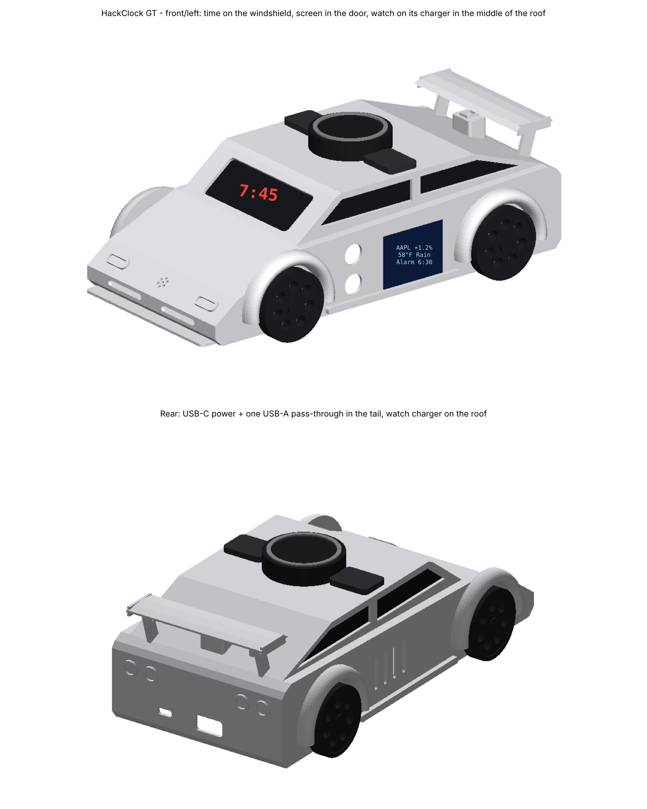
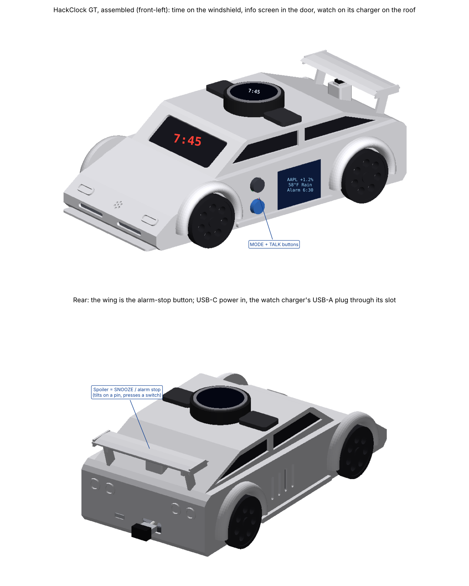
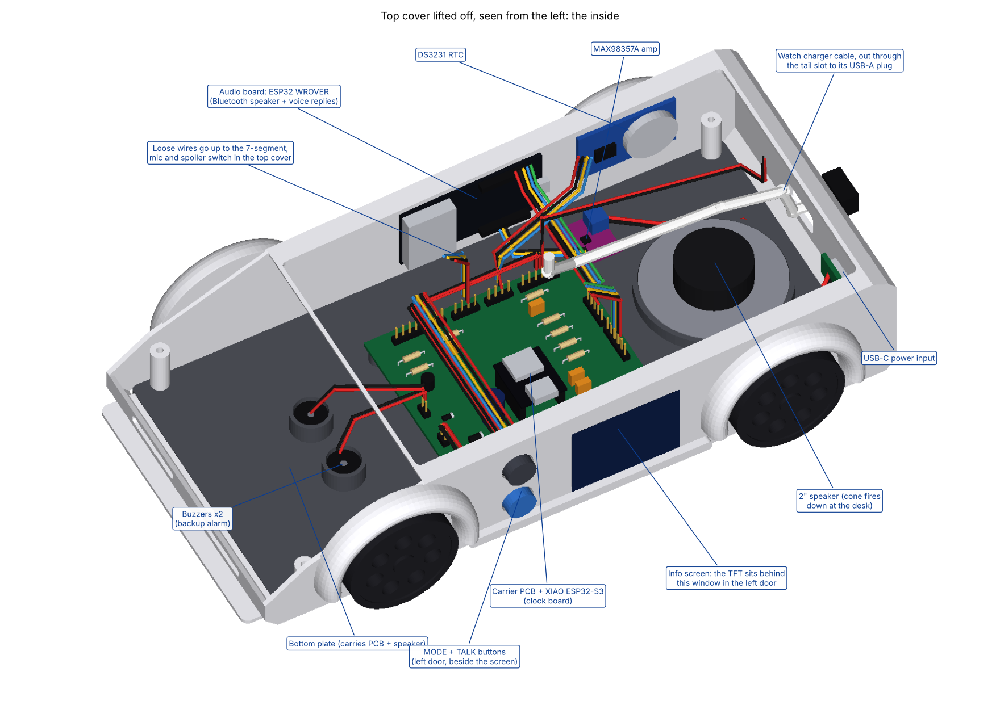
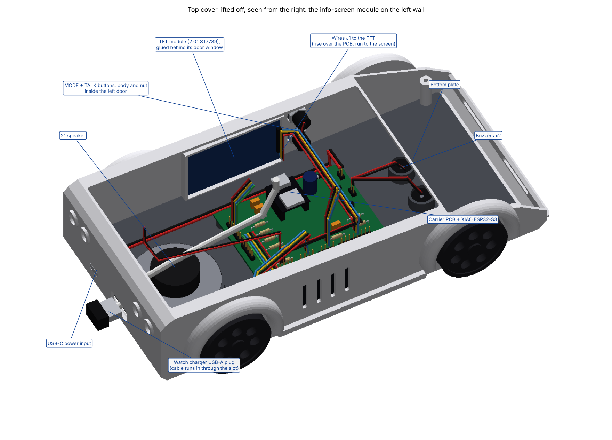
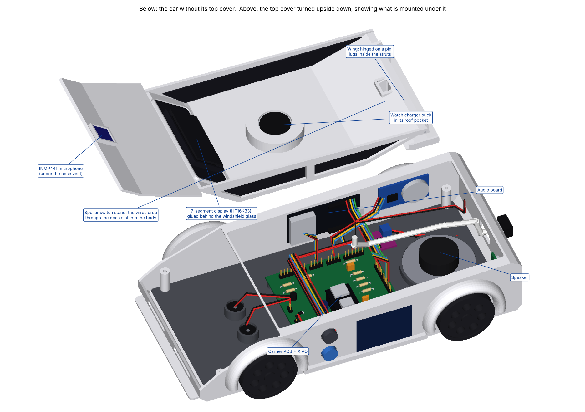
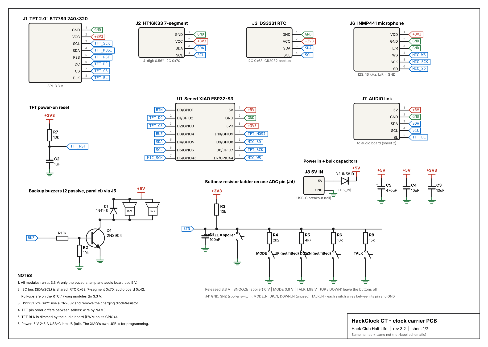
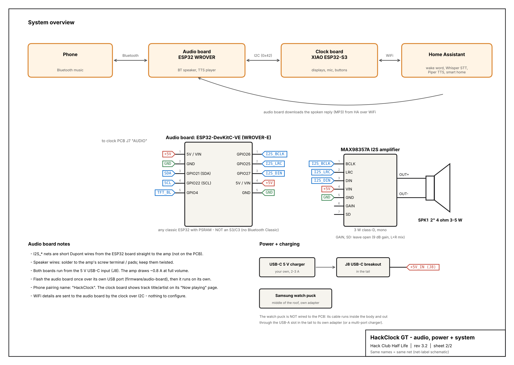

# HackClock GT: hypercar-shaped alarm clock, speaker, voice assistant + charging dock

A smart bedside clock shaped like an (original) hypercar, built for **Hack Club Half Life, week 4 (displays)**.
It can replace an Alexa and a pile of chargers:

- **Time on the windshield**: a 7-segment display behind smoked glass
- **Info screen in the left door**: 2.0" TFT
- **Watch charging on the roof**: Samsung's magnetic puck sits flush in a round pocket in the middle of the roof

- **7-segment display (HT16K33)**: big, bright time you can read from bed
- **2.0" TFT (ST7789)**: weather, **live stocks**, **news**, **phone messages**, and **Now playing**
- **Bluetooth speaker**: pair your phone with "HackClock" and play music through a 2" speaker (MAX98357A amp)
- **Voice assistant**: say the wake word (or press TALK) and ask for alarms, timers, weather, stocks,
  news, music control, or smart-home commands, through your own **Home Assistant** server
- **Alarms** through the speaker (gentle volume ramp), with two **buzzers** as a backup
- **Slap the spoiler** to stop the alarm (the wing is a big hinged button), plus **MODE** and **TALK** buttons in the left door beside the screen
- **DS3231 real-time clock**: keeps time and alarms going if WiFi drops
- **Web settings page** at `http://hackclock.local`
- **3D-printed hypercar body** (original design: low nose, flared fenders, splitter, hinged rear wing; 254 x 134 x 80 mm) + custom 2-layer carrier PCB



### Everything in place



**Top cover lifted off** (hood + roof + windshield, plus the wing and its switch; the body is really one print, this just shows the inside) - what is inside:




**Under the top cover**: the microphone, 7-segment display, the watch puck's pocket and the spoiler's switch stand:



## What's in this repo

| Folder | What |
|---|---|
| `firmware/clock/` | PlatformIO project for the **XIAO ESP32-S3** (displays, buttons, mic, voice, WiFi data) |
| `firmware/audio-board/` | PlatformIO project for the **ESP32 WROVER** (Bluetooth speaker, voice replies, tones) |
| `hardware/schematic/` | `schematic.pdf` (2 sheets: clock PCB, audio board + system) |
| `hardware/pcb/` | `hackclock.kicad_pcb` (KiCad 8, fully routed) + generator + preview |
| `case/` | `stl/` ready to print (body, wing, bottom plate, wheel x4, windshield, side glass x2); `case_gen.py` = parametric source |
| `docs/WIRING.md` | pin maps, every connection, soldering + mounting |
| `docs/HOME_ASSISTANT.md` | voice setup step by step + what you can say |
| `BOM.csv` | bill of materials (~$71; your Samsung chargers are reused) |

## How it works

```
   Phone ──Bluetooth──►  AUDIO BOARD (ESP32 WROVER) ──I2S──► MAX98357A ──► 2" speaker
                              ▲  │ dims TFT backlight
                     I2C 0x42 │  │ downloads spoken replies (MP3) over WiFi
                              ▼  ▼
   USB-C 5V ────────► CLOCK BOARD (XIAO ESP32-S3) ◄──WiFi──► Home Assistant (wake word, Whisper, Piper)
                │ SPI: TFT        │ I2C: 7-segment, RTC     │ I2S: INMP441 mic
                │ ADC: 3 switches │ PWM: backup buzzers     └──► internet: weather, stocks, news, ntfy
   your Samsung watch puck (middle of the roof): own cable, out through a USB-A slot in the tail
```

**Why two ESP32s?** Phones send music over *Bluetooth Classic*, which the ESP32-S3 doesn't have.
The original ESP32 does, so it acts as the speaker, and the S3 does everything else. They talk over
the same I2C bus as the RTC and 7-segment display.

**Voice:** the clock streams 16 kHz audio from the INMP441 mic to Home Assistant's
[Assist pipeline](https://developers.home-assistant.io/docs/voice/pipelines/) over a WebSocket.
HA detects the wake word and turns your speech into text. The clock handles clock-type commands
itself; anything else (lights, questions) goes to HA's conversation agent. HA turns the reply into
speech, and the audio board plays it while pausing your music.

The 3 switches (spoiler, MODE, TALK) share **one** analog pin through a resistor ladder, which is how everything fits on the XIAO.




## Bill of materials (short)  (buy links: docs/BOM_LINKS.md)

| Part | ~USD |
|---|---|
| Seeed XIAO ESP32-S3 + ESP32 WROVER dev board | 16.50 |
| 2.0" ST7789 TFT + HT16K33 7-segment + DS3231 RTC | 11.50 |
| INMP441 mic, MAX98357A amp, 2" 4 ohm speaker | 8.50 |
| 2 push buttons + spoiler switch, 2 buzzers, USB-C breakout, small parts, wires, screws, tape | ~9 |
| PCB + shipping | ~17 |
| PETG filament (body, wheels, smoke "glass") | 8.50 |
| **Total** | **~$71** |

Already yours: the Samsung watch puck and its adapter, plus a USB-C charger for the clock.
Not included: a Home Assistant server for voice. Full list: [`BOM.csv`](BOM.csv).

## Build it

1. **Order the PCB**: open `hardware/pcb/hackclock.kicad_pcb` in KiCad 8, press **B** (fills
   the ground planes), run **Inspect > Design Rules Checker**, then **File > Fabrication Outputs >
   Gerbers + Drill Files**. Zip and upload to JLCPCB.
2. **Print the car**: needs a **256 mm bed**. Body upright (open bottom down, tree supports),
   bottom plate flat, 4 wheels in black, windshield + 2 side glass in translucent smoke PETG.
   The wing prints on its own (upside down as exported, no supports needed beyond a brim). PETG, 0.2 mm, 3 walls, 15% infill. Measure your TFT and watch puck first; if they
   differ, change `TFT_POCKET` or `PUCK` at the top of `case/case_gen.py` and run it again.
3. **Solder + wire**: [`docs/WIRING.md`](docs/WIRING.md), including the spoiler button (section 3c).
4. **Flash both boards** (VS Code + PlatformIO extension):
   - open `firmware/audio-board`, plug in the ESP32 WROVER, click **Upload**
   - open `firmware/clock`, plug in the XIAO, click **Upload** (hold **B** while plugging in if it won't upload)

## First-time setup

1. Plug a USB-C charger into the tail. The door screen says *join HackClock-Setup*.
2. Join WiFi **HackClock-Setup** on your phone, choose your home WiFi and type the password.
3. Open **http://hackclock.local** and set alarms, stocks (free Finnhub key), location, time zone, volume.
4. **Bluetooth:** on your phone, pair with **HackClock** and play something.
5. **Voice:** follow [`docs/HOME_ASSISTANT.md`](docs/HOME_ASSISTANT.md), then paste your HA address + token on the web page.
6. **Charging:** snap the watch onto the puck in the middle of the roof, with its strap running **side to side**
   (so it drapes over the sides, not toward the windshield).

## Phone messages

Install the free **ntfy** app and subscribe to the topic shown on the home page (e.g.
`hackclock-3fa29c1b`). Anything you send shows on the clock with a chime, and you can say
"read my messages". From a laptop: `curl -d "Dinner is ready!" ntfy.sh/<your topic>`.

## Buttons

| Button | Normal | On "Now playing" | Alarm ringing | Setting an alarm |
|---|---|---|---|---|
| **Slap the spoiler** | night dim on/off | | **stop** the alarm | |
| **Spoiler** held 1.5 s | cancel pending snooze | play / pause | | |
| **MODE** | next page | next page | **snooze** 9 min | |
| **MODE** held 1.5 s | brightness +1 (wraps) | | | |
| **MODE** held 8 s | forget the WiFi (re-run setup) | | | |
| **TALK** | talk to the assistant | | stop | |
| **TALK** held | wake word on/off | | | |

There are no UP/DOWN buttons. Set alarms, volume, brightness and time zone on the settings page
(`http://hackclock.local`) or by voice. The time sets itself from the internet.

## Regenerating the design files

```bash
cd hardware/pcb && python3 generate_pcb.py && python3 render_pcb.py
cd hardware/schematic && python3 draw_schematic.py
cd case && python3 case_gen.py && python3 check_stl.py && python3 render_case.py   # car body
cd case && python3 render_assembly.py                                           # all parts in place + top cover off
```
Only `numpy` and `matplotlib` are needed.

## Status / known limits

- The firmware was written against Arduino-ESP32 2.0.x (PlatformIO `espressif32@6.9.0`) and **has not been
  compiled or run on hardware yet**. Expect a few small fixes on the first build.
- No echo cancellation: the wake word struggles over loud music, but TALK always works.
- WiFi and Bluetooth share one radio on the audio board, so music can stutter briefly while a voice reply downloads.
- Voice needs a Home Assistant server; the clock, speaker, stocks, news and messages all work without one.
- The speaker fires down at the desk, so it sounds best on a hard, flat surface.

---
Made for Hack Club Half Life. MIT licence.
