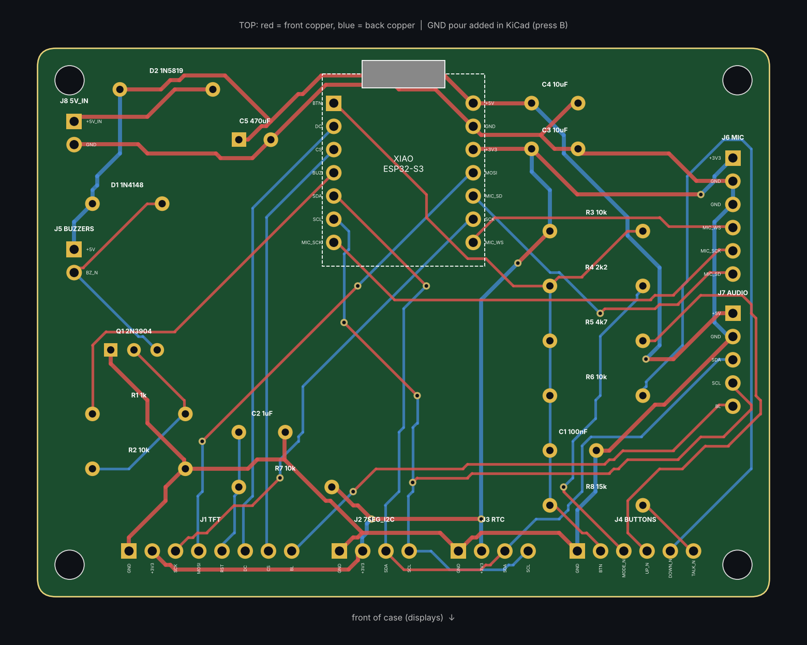

# Wiring guide (v2: clock + speaker + voice)

There are **two boards**:

- the **clock board**: a Seeed XIAO ESP32-S3 plugged into the custom carrier PCB. It runs the displays, buttons, mic and voice.
- the **audio board**: an ESP32 WROVER dev board wired with Dupont jumpers. It handles Bluetooth music, the speaker, and dims the TFT backlight.

Everything else is a module that plugs into a PCB header. **Wire by pin NAME, not by
position**: different sellers order the pins differently.



## 1. XIAO ESP32-S3 pin map (on the PCB)

| XIAO | GPIO | Goes to |
|---|---|---|
| D0 | 1 | Buttons (resistor ladder, analog) |
| D1 | 2 | TFT DC |
| D2 | 3 | TFT CS |
| D3 | 4 | Buzzer transistor (backup alarm) |
| D4 | 5 | I2C SDA: RTC, 7-segment, audio board |
| D5 | 6 | I2C SCL |
| D6 | 43 | Mic SCK |
| D7 | 44 | Mic WS |
| D8 | 7 | TFT SCL (SCK) |
| D9 | 8 | Mic SD |
| D10 | 9 | TFT SDA (MOSI) |
| 5V | - | 5 V rail (fed from J8 through D2) |

## 2. PCB headers -> modules

| Header | Pins (PCB order) | Connect to |
|---|---|---|
| **J1 TFT** | GND, 3V3, SCK, MOSI, RST, DC, CS, BL | TFT: GND, VCC, SCL, SDA, RES, DC, CS, BLK |
| **J2 7SEG** | GND, 3V3, SDA, SCL | HT16K33 backpack: GND (-), VCC (+), SDA (D), SCL (C) |
| **J3 RTC** | GND, 3V3, SDA, SCL | DS3231: GND, VCC, SDA, SCL |
| **J4 BUTTONS** | GND, SNZ, MOD, UP, DN, TLK | **SNZ** = the spoiler's tactile switch, **MOD** = MODE button, **TLK** = TALK button; each switch: one leg to its pin, the other to **GND** (daisy-chain GND). **UP and DN stay empty** (no buttons) |
| **J5 BUZZERS** | +5V, BZ- | both buzzers in parallel: + legs to +5V, - legs to BZ- |
| **J6 MIC** | 3V3, GND, LR, WS, SCK, SD | INMP441: VDD, GND, L/R, WS, SCK, SD |
| **J7 AUDIO** | 5V, GND, SDA, SCL, BL | audio board: 5V/VIN, GND, GPIO21, GPIO22, GPIO4 |
| **J8 5V IN** | 5V, GND | USB-C power breakout in the tail: VBUS, GND |

Notes:
- **Power** goes into J8 from a 5 V 2-3 A USB-C charger. Diode D2 stops it from fighting
  the XIAO's own USB port, so you can leave it powered while programming.
- The **7-segment backpack** must be powered from 3V3 (J2 does this), because its I2C pull-ups go to its VCC.
- **DS3231 "ZS-042"** with a normal CR2032: desolder the small charging diode (or the 200 ohm resistor next to it).
- If your **HT16K33** board has address jumpers, leave them open (0x70).

## 3. Audio board (Dupont wires, not on the PCB)

| ESP32 WROVER pin | Goes to |
|---|---|
| 5V / VIN | J7 5V, **and** MAX98357A VIN |
| GND | J7 GND, **and** MAX98357A GND |
| GPIO21 | J7 SDA |
| GPIO22 | J7 SCL |
| GPIO4 | J7 BL (TFT backlight dimming) |
| GPIO26 | MAX98357A BCLK |
| GPIO25 | MAX98357A LRC |
| GPIO27 | MAX98357A DIN |

MAX98357A: leave **GAIN** and **SD** unconnected. The speaker goes on the amp's **+ / -** output
(screw terminal or pads). Never connect the speaker to GND.

## 3b. Power + your chargers

```
your 5 V USB-C charger --> J8 USB-C breakout (tail slot) --> clock PCB 5V IN --> audio board via J7

Samsung watch puck (middle of the roof) --cable inside the body-->  USB-A slot (tail) --> its own adapter
```

- The watch charger isn't wired to the electronics. It just lives in the car, so it keeps Samsung's
  charging and safety features.
- **Watch puck:** press it into the round pocket in the **middle of the roof**, face flush with the roof, cable down
  through the hole in the pocket floor. Put the watch on with the strap running side to side.
- The tail has **one USB-A-sized slot** (18.5 x 9.5 mm) for the puck's cable. Push the cable's USB-A plug out through it
  from the inside before you fix the puck in place. The small slot next to it is the clock's USB-C power input.
  A 2-port USB-C charger behind the clock can power both.

## 3c. Spoiler button (SNOOZE / alarm stop)

The rear wing is a printed part that tilts on a pin, and it presses a small switch.

1. Solder two wires (about 25 cm) to a 6x6 mm tactile switch. Glue it on the seat at the top of the stand on the rear deck.
2. Drop the two wires down through the stand and the slot in the deck into the body. Connect one to **J4 SNZ** and the other to **J4 GND**.
3. Put the two hinge lugs of the wing **inside** the struts, line up the holes, and push a 1.75 mm filament piece (or a 2 mm rod),
   about 80 mm long, through strut, lug, lug, strut. Melt or glue the ends so it can't slide out.
4. Slap test: the front edge of the wing rests on the switch and clicks it when pressed about half a millimetre. The wing's tilt should be
   free. If the switch is too tall or short, add or remove a thin shim under it (the wing front should just touch the switch).

Pressing the wing stops a ringing alarm. MODE snoozes it for 9 minutes.

> Why two ESP32s? Phones stream music over **Bluetooth Classic (A2DP)**. The ESP32-S3 only has
> Bluetooth Low Energy, so the original classic ESP32 does the speaker job.

## 4. Soldering order (carrier PCB)

1. Resistors R1-R8 2. Diodes D1 (1N4148) and D2 (1N5819): **the band goes on the marked end**
3. Ceramic capacitors C1-C4 4. C5 470 uF: **long leg (+) into the square pad**
5. Q1 (flat face toward the label, E-B-C) 6. XIAO female headers (solder with the XIAO plugged in)
7. Male headers J1-J8.

Before plugging anything in, check with a multimeter that 5V-GND and 3V3-GND aren't shorted.

## 5. Mounting in the car body

The body is one print. The **bottom plate** screws on underneath with 4x M3x8 screws and carries the
boards. Everything with a window, button or grille mounts to the body.

| Part | Where | How |
|---|---|---|
| Windshield glass (smoke PETG) | inside the windshield, in the locating lip | glue the edges (clear CA / epoxy) |
| 7-segment display | in the frame on the back of the windshield glass | hot glue at the corners |
| Side glass x2 | inside the cabin side walls, over the windows | glue the edges |
| TFT | pocket inside the **left door** | hot glue / Kapton tape |
| Watch puck | round pocket in the **middle of the roof**, face flush | press fit (+ dab of glue), cable down through the floor |
| MODE + TALK buttons | two holes in the **left door**, beside the screen window (MODE on top) | nuts from the inside |
| Spoiler switch (6x6 tactile) | seat on the rear-deck stand under the wing's front edge, wires drop through the deck slot | glue the switch on its seat, run the 2 wires into the body |
| Wing | hinged on the two struts with a 1.75-2 mm pin, lugs inside the struts | see section 3c |
| Mic (INMP441) | frame under the nose-top vent, **port facing up/forward** | foam gasket + hot glue |
| USB-C power breakout (J8) | small slot in the tail | hot glue / epoxy from inside |
| Audio board (ESP32) | inside the right wall, behind the door vents | foam tape |
| MAX98357A | bottom plate next to the speaker | foam tape |
| RTC | anywhere on a wall | foam tape |
| Carrier PCB | 4 standoffs on the bottom plate | 4x M3x8 self-tapping |
| Speaker (2") | ring on the bottom plate, cone facing **down** at the grille | hot glue / silicone around the rim |
| Buzzers | two small rings on the bottom plate (under the hood) | press fit |
| Wheels x4 | glue onto the four arches (hub at the arch centre) | CA glue |

Leave enough wire slack that the bottom plate can sit beside the car while you plug things in, then flip it up and screw it on.

## 6. Printing

| Part | Orientation | Notes |
|---|---|---|
| `hackclock_wing.stl` | as exported (upside down, flat side up) | 92 x 26 mm, small; brim helps. Hinge lugs print upwards |
| `hackclock_body.stl` | upright, open bottom on the bed | 252 x 133 x 69 mm, needs a **256 mm bed** (Bambu A1/P1/X1, Prusa MK4); tree supports for hood, roof, windshield, flares |
| `hackclock_bottom.stl` | flat | no supports |
| `hackclock_wheel.stl` | flat, print 4 | black |
| `hackclock_windshield.stl`, `hackclock_side_glass.stl` (x2) | flat | translucent smoke PETG, 100% infill, or cut from 2 mm smoked acrylic |
